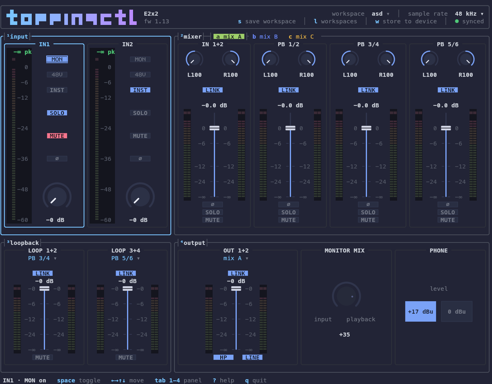

<h1 align="center"></h1>

A terminal app for the TOPPING E2x2 USB audio interface, on macOS and Linux. It controls
the device over its HID interface (USB `152a:8752`), the way TOPPING's own Professional
Control Center does: inputs (gain, 48V, mute, solo, phase, monitor, instrument), the
three mixes, loopback, the output, and the device's settings. It has a TUI and a CLI for
scripts.



The TUI shows the official app's four panels side by side: **Input** (gain knobs and
switches per channel), **Mixer** (one strip per source, for mix A, B or C), **Loopback**
and **Output** (faders, sources and levels). Meters run before and after the faders, with
clip lights. The header shows the device, the sample rate and the open workspace; the
footer names what is focused and the keys that act on it, or a notice. Switches are
coloured pills. The focused control has a flat accent outline in pixel mode and reversed
cells in text. The arrows only move focus, alsamixer-style; `+` and `-` adjust.

## Install

With a package manager (#22), from the first release after v0.1.0. The Linux packages
install the udev rule (see [Linux setup](#linux-setup)), so after installing, unplug the
E2x2 and plug it back in.

**Arch Linux (AUR):** `toppingctl-bin` (prebuilt) or `toppingctl` (built from source).

```sh
yay -S toppingctl-bin
```

**Debian and Ubuntu (amd64, arm64):** add the signed apt repository once, then install
and upgrade with apt as usual.

```sh
sudo install -d -m 0755 /etc/apt/keyrings
curl -fsSL https://ktoulgaridis.github.io/apt/toppingctl.asc |
  sudo gpg --dearmor -o /etc/apt/keyrings/toppingctl.gpg
echo "deb [signed-by=/etc/apt/keyrings/toppingctl.gpg] https://ktoulgaridis.github.io/apt stable main" |
  sudo tee /etc/apt/sources.list.d/toppingctl.list
sudo apt-get update
sudo apt-get install toppingctl
```

The key's fingerprint is `91A86B2085944347FA9C7F92F29E31E08B5B2DCE`
(`gpg --show-keys /etc/apt/keyrings/toppingctl.gpg`). Each release also has the `.deb`
files attached.

**Homebrew (macOS, Linux):**

```sh
brew install ktoulgaridis/tap/toppingctl
```

On Linux, Homebrew can't install the udev rule; `brew info toppingctl` shows how.

From a clone of this repository, with a Rust toolchain:

```sh
cargo install --path .     # puts toppingctl in ~/.cargo/bin
# or
cargo build --release      # target/release/toppingctl
```

On Linux the build needs libudev's headers (`libudev-dev` on Debian and Ubuntu,
`systemd-devel` on Fedora).

Prebuilt archives for macOS and Linux (x86_64 and arm64) are on the
[releases page](https://github.com/ktoulgaridis/toppingctl/releases) (#31), each with a
`SHA256SUMS`.

## Linux setup

**Access without sudo.** The E2x2's hidraw node is root-only by default. Install the udev
rule in [`packaging/linux/`](packaging/linux/70-toppingctl.rules); it gives the device to
the user at the local seat and nothing else. Steps, and how to undo them:
[`packaging/linux/README.md`](packaging/linux/README.md).

**Recording gives only silence.** The E2x2's ALSA control `'Mic',0` (the capture
switch) can be off, and then every capture is exact zeros. PipeWire turns it off again
whenever the card profile changes. Take the card from PipeWire, then switch capture on:

```sh
pactl set-card-profile alsa_card.usb-Topping_E2x2-00 off
amixer -c E2x2 sset 'Mic',0 cap
```

## Pixel mode and the text fallback

In a terminal with the kitty graphics protocol (kitty, Ghostty) the knobs, faders and
pills are drawn as pixel images over the text grid. Everywhere else, and with
`TOPPINGCTL_PIXELS=0`, the TUI draws them in text: every control works the same either
way. `NO_COLOR` turns the colours off.

## Keys

Press `?` in the TUI for this list. The help screen is the source of truth; a test keeps
this table in step with it.

| Key | Does |
|---|---|
| `Tab` `Shift-Tab` | next / previous panel |
| `1` `2` `3` `4` | input, mixer, loopback, output |
| `←` `→` | move: the control beside, or the next strip |
| `↑` `↓` | move: up / down a strip, from its name |
| `+` `=` `-` `_` | adjust the knob or fader: 1 dB / 5 % |
| `PgUp` `PgDn` | the same ×10 |
| `0` | reset the knob or fader (gain −0 dB, fader 0 dB) |
| `space` `enter` | toggle the switch; open a source's menu |
| `enter` | on a strip's name: rename it |
| `a` `b` `c` | show mix A / B / C |
| `r` | sample rate list (sets it through the OS) |
| `s` | save the workspace (on Default: save as…) |
| `l` | workspaces: pick, save, delete, new, save as |
| `w` | store to the device's memory (download) |
| `e` | settings: device, workspaces folder, versions |
| `?` | this help |
| `q` `Ctrl-C` | quit |
| click | focus a strip; flip a switch; pick a mix; s l w e |
| wheel | turn a knob, move a fader (Shift ×10); next source |
| drag | turn a knob, move a fader (up / down) |
| double-click | reset a knob or fader |
| | LINK: one fader and switch set, or an L and an R of each |
| | loopback, output: 1 dB a step, ×10 is 5 dB, −90 dB is −∞ |
| | PHONE: space or a click sets the level switch |

## Mouse

Everything on screen takes a click: a strip takes focus, a switch flips, a mix tab picks
the mix, and the header's `s`, `l`, `w` and `e` buttons do what their keys do. The wheel
turns the knob or fader under the pointer (with Shift, ten steps at a time) and steps a
source to the next one; dragging up or down turns a knob or moves a fader; a double-click
resets it. Dialogs take clicks too.

## Workspaces

A workspace is a named snapshot of every setting, as in the official app's workspace
combo. `l` opens the list: pick one to load it, or save, delete, start a new one from
the defaults, or save as a new name. `s` saves the open workspace (on Default it asks
for a name). An auto-save toggle in the list saves the open workspace on every change.

Coming from the official app? "Import from TOPPING app…" in the list (shown when the
app's workspace folder has E2x2 workspaces, macOS only) saves one of its workspaces as
a toppingctl workspace under the same name; `toppingctl import <file.TPwork> [name]`
does the same from the command line. An import never sends anything and never brings
48V across: a workspace that had 48V on says so.

Workspaces are JSON files in `<config>/toppingctl/workspaces/` (`<config>` is
`$XDG_CONFIG_HOME` when set, else `~/.config` on Linux and
`~/Library/Application Support` on macOS). The Settings dialog (`e`) can point them at
another folder: Enter on "Workspaces folder" types a full path (`~` is your home; empty
goes back to the default), and the folder is created if missing. Nothing is moved: the
list reads the new folder, and the open workspace goes back to Default if it isn't
there. The open workspace, auto-save and the folder are kept in
`<config>/toppingctl/workspaces.json`; the state toppingctl last set is kept in
`<config>/toppingctl/state.json`.

## Store to the device

The E2x2 starts up with the settings in its own memory. `w` opens the Download dialog,
as in the official app: save the current workspace and download, save as a new
workspace and download, or download to the device only. Nothing is stored without that
choice.

## Command line

With no arguments `toppingctl` starts the TUI. With a command it does one thing and
exits:

```sh
toppingctl set in1.gain 12dB        # change one setting and save it
toppingctl get mix.a.in1.fader      # print one setting
toppingctl dump                     # every setting (--json: the saved-state JSON)
toppingctl store                    # store the settings in the device's memory (asks)
toppingctl init                     # first run: push the defaults (asks)
toppingctl import E2X2_Live.TPwork  # save an official app workspace as "Live"
```

`toppingctl --help` lists every path and value. Exit status: 0 ok, 2 usage error or not
confirmed, 1 device error.

The device can't be read back, so every device command, and the TUI on start, first pushes the
state toppingctl last set. On the first run there is nothing saved: the TUI asks before
pushing the defaults, and the CLI wants `init`.

## 48V phantom power

48V can damage equipment that doesn't expect it, so toppingctl never turns it on by
itself. It is never pushed on start, never restored from the saved state and never
loaded from a workspace: those keep the device's own 48V. Turning it on in the TUI opens
a confirm dialog (No is the default); `toppingctl set in1.48v on` asks the same, and
`--yes` answers for it. Turning it off needs no confirmation.

## Sample rate

The sample rate isn't a HID setting; the OS owns it. On Linux toppingctl reads it from
ALSA (or PipeWire's graph rate while the card is idle), and `r` sets it through PipeWire
(`clock.force-rate`, with `pw-metadata`).

On macOS toppingctl reads and sets the E2x2's nominal sample rate through CoreAudio, as
the official app does, so the header and Audio MIDI Setup agree. If CoreAudio refuses a
rate (another app holds the E2x2 in hog mode, say), the footer says so.

## The official TOPPING app

toppingctl and TOPPING Professional Control Center talk to the device over the same
interface and may fight over it. When the official app is running, toppingctl says so:
a notice in the TUI and a warning on stderr from the CLI. It doesn't stop you. Quit the
official app for predictable results.

## Known limits

- **Phone volume is analog only.** The front knob sets it; there is no register for it.
  toppingctl sets only the PHONE level switch.
- The device has no full-state read, so toppingctl can only show what it last set (see
  [Command line](#command-line)).

## License

Licensed under either of [Apache License, Version 2.0](LICENSE-APACHE) or
[MIT license](LICENSE-MIT) at your option.

Unless you explicitly state otherwise, any contribution intentionally submitted for
inclusion in this work, as defined in the Apache-2.0 license, shall be dual licensed
as above, without any additional terms or conditions.
